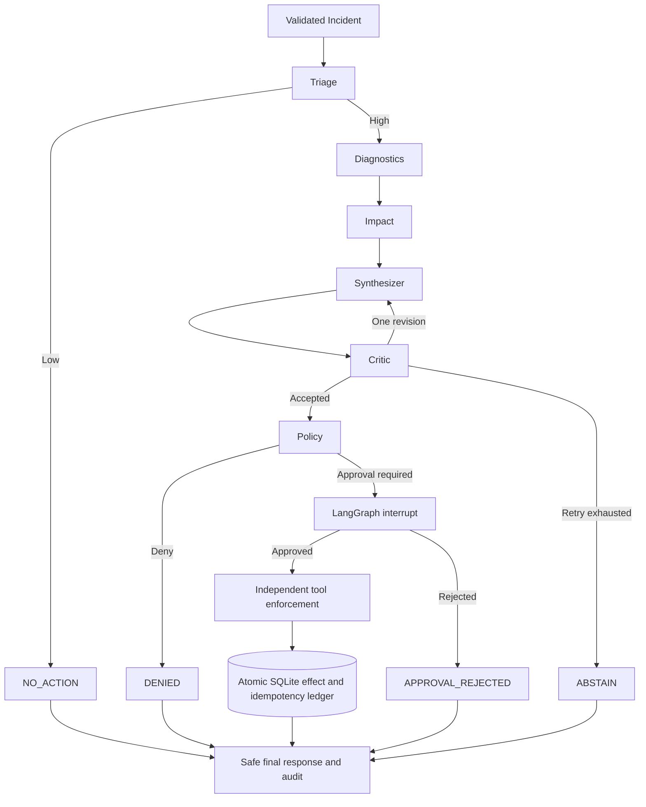

# Architecture

LangGraph persists graph checkpoints in SQLite by workflow thread. Audit records and effect records are tenant-scoped in the same local SQLite database. Tool effect creation and its idempotency evidence are transactionally committed together. A process failure after this commit is reconciled by querying the effect ledger; replay cannot create a second effect for the same deterministic key.
